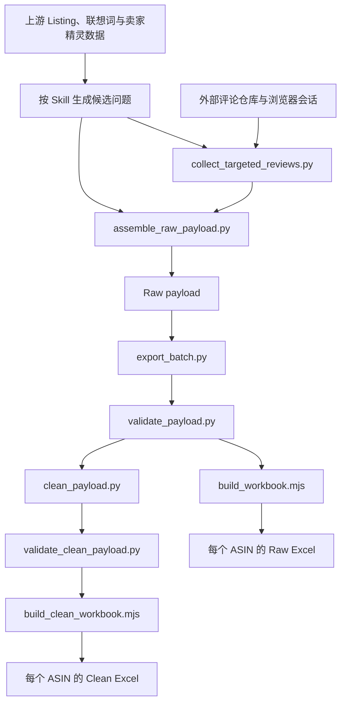

# Amazon Alexa 问答构建器

## 一眼看懂

- 这是什么：整理亚马逊商品的 Alexa 双语问答，附评论证据。
- 什么时候用：准备商品页问答，或核对每条答案有没有评论支持时。
- 给它什么：候选问题、Listing 信息和评论证据。
- 它给你什么：每个商品两份表格，原始记录和清洗问答。

## 项目简介

`amazon-alexa-qa-builder` 是面向 Amazon US 商品的 Alexa/Rufus 问答整理工具，也可作为 Codex Skill 使用。它接收当前商品的候选问题与评论证据，保留原始来源映射，再清洗成有证据边界的双语问答；每个 ASIN 分别导出 Raw、Clean 两个 Excel。

仓库提供评论采集适配器、数据组装、清洗、校验及出表脚本。Listing、联想词、卖家精灵数据的取得和候选问题生成由 [SKILL.md](SKILL.md) 约定的上游流程完成，仓库没有独立的一键全流程入口。

## 核心功能

- Raw 保留问题、关键词、查询词与评论 ID 的多对多映射，重复来源和零评论命中记录均可保留。
- 定向评论适配器先查询目标商品，再查询竞品，支持低并发和断点续跑；相同网络查询复用结果后仍保留候选问题映射。
- Clean 根据输入的 `relevance_status` 排除污染记录，按 `semantic_key` 合并真正同义的问题；未提供语义键时按规范化问题文本合并，不自动推断语义。
- Raw 与 Clean 默认不限问题数量；Clean 仅在明确传入上限时截取结果。
- 校验目标 ASIN 和答案证据：竞品评论只能说明买家关注，不能证明目标商品功能；缺少目标证据时使用固定的中英文未验证答案。
- 批量导出每个 ASIN 的两个独立、单工作表 Excel，并设置冻结首行、筛选和自动换行。

| 文件 | 工作表 | 内容 |
| --- | --- | --- |
| `{ASIN}_QA_Raw.xlsx` | Q&A Raw Data | 20 列原始来源、查询与评论映射 |
| `{ASIN}_QA_Clean.xlsx` | Alexa Q&A | 18 列清洗问答、证据、缺口与建议 |

## 技术栈

| 用途 | 技术与约束 |
| --- | --- |
| 数据处理与命令行 | Python 3.10–3.13；`.python-version` 固定为 3.12.13 |
| 评论采集适配 | Playwright `>=1.55,<2`，托管 Chromium 或本机 Chrome，以及外部评论仓库 |
| Excel 出表 | Node.js 与 Codex 工作区提供的 `@oai/artifact-tool`；仓库未锁定 Node.js 和该包的版本 |
| 打包 | setuptools；项目版本 `1.0.0`，安装包提供 `amazon-alexa-qa` 命令 |
| 测试 | Python unittest、PowerShell 辅助脚本、GitHub Actions |

## 快速开始

### 环境准备

```bash
git clone https://github.com/fubo-ops/amazon-alexa-qa-builder.git
cd amazon-alexa-qa-builder
python -m venv .venv
```

macOS / Linux 激活环境：

```bash
source .venv/bin/activate
```

Windows PowerShell 激活环境：

```powershell
.venv\Scripts\Activate.ps1
```

在线采集所需依赖：

```bash
python -m pip install -r requirements.txt
python -m playwright install chromium
```

作为 Skill 使用时，将仓库放入 `~/.codex/skills/amazon-alexa-qa-builder`。出表还需要已提供 `@oai/artifact-tool` 的 Node.js 环境；`requirements.txt` 不安装 Node.js 依赖。以下命令直接调用脚本，不依赖安装命令行入口。

### 离线验证与批量出表

仓库 `tests/fixtures/` 是合成测试数据，基础校验和清洗测试无需在线采集：

```bash
python -B -m unittest discover -s tests -v
python -B scripts/validate_payload.py tests/fixtures/valid_payload.json
```

准备好 Node.js 与依赖路径后，可用两个合成 ASIN 验证批量导出：

```bash
python scripts/export_batch.py tests/fixtures/clean_35_questions.json tests/fixtures/valid_payload_2.json --output-dir outputs/sample --max-clean-questions unlimited --node node --node-modules "<CODEX_NODE_MODULES>"
```

将 `<CODEX_NODE_MODULES>` 替换为当前 Codex 运行环境中包含 `@oai/artifact-tool` 的绝对目录。预期生成四个 `.xlsx`；出表工具生成的 `.inspect.ndjson` 检查文件也会被 Git 忽略，交付前按 Skill 要求清理。设置 `ALEXA_QA_BATCH_OUTPUT` 指向该输出目录后再次运行 unittest，才会执行工作簿数量和结构检查；未设置时该项跳过。

Windows 可使用 [离线测试脚本](tests/run_offline_tests.ps1)，同时显式传入当前环境的 `-Python`、`-Node` 和 `-NodeModules`，不要依赖其中旧的本机默认路径。

### 真实任务

按 [来源流程](references/source-flows.md) 准备当前 ASIN 的 Listing 事实、关键词和候选问题，再按 [数据契约](references/data-contract.md) 组织输入。在线采集还需准备上游评论仓库及其依赖。评论适配器的 `--review-repo` 必须指向兼容的上游评论仓库，目录内应有 `scripts/amazon_reviews.py`；代码默认值是旧 Windows 工作目录，其他环境必须覆盖。

```bash
python scripts/collect_targeted_reviews.py --help
python scripts/assemble_raw_payload.py --help
python scripts/export_batch.py --help
```

取得并校验每个 ASIN 的 Raw payload 后，用上面的 `export_batch.py` 命令替换为实际输入路径。每个商品使用独立运行目录，输出目录只放本次请求的工作簿。登录状态由本机浏览器维护；运行输入、评论数据、浏览器资料、断点和输出文件均不提交到 Git。

## 项目结构

以下完整结构对应 `git ls-files`；运行目录和生成文件未列入：

```text
amazon-alexa-qa-builder/
├── .github/
│   └── workflows/
│       └── test.yml
├── .gitignore
├── .python-version
├── README.md
├── SKILL.md
├── agents/
│   └── openai.yaml
├── pyproject.toml
├── references/
│   ├── data-contract.md
│   └── source-flows.md
├── requirements.txt
├── scripts/
│   ├── __init__.py
│   ├── assemble_raw_payload.py
│   ├── build_clean_workbook.mjs
│   ├── build_workbook.mjs
│   ├── clean_payload.py
│   ├── collect_targeted_reviews.py
│   ├── export_batch.py
│   ├── validate_clean_payload.py
│   └── validate_payload.py
└── tests/
    ├── fixtures/
    │   ├── candidates.json
    │   ├── clean_35_questions.json
    │   ├── review_evidence.json
    │   ├── valid_payload.json
    │   └── valid_payload_2.json
    ├── run_offline_tests.ps1
    └── test_offline.py
```

`SKILL.md`、`agents/` 和 `references/` 保留 Skill 所需的路径；当前没有需要迁入 `docs/` 的根目录过程文档，也没有已跟踪的运行产物。

## 架构图



## 当前状态与开发计划

已有 Raw 组装、目标评论适配、Clean 清洗、证据校验和批量导出实现。unittest 覆盖来源保留、不限量、语义键合并、答案证据边界、商品隔离及工作簿结构；CI 配置了 Windows、macOS、Ubuntu 和 Python 3.10/3.13 的基础测试。

当前 CI 没有准备 Node.js 出表依赖，也没有设置 `ALEXA_QA_BATCH_OUTPUT`，因此工作簿导出检查默认跳过。完整出表需另行提供 Codex Node.js 依赖并执行上述离线流程。在线采集依赖外部评论仓库、登录会话和站点页面，仓库没有自带上游代码；现有路径兼容性和真实业务环境的验收记录待补充。

仓库未提供独立开发路线图，后续开发计划待补充。

## 文档

- [Skill 入口与完整工作流程](SKILL.md)
- [候选、Raw、Clean 字段与答案证据契约](references/data-contract.md)
- [当前任务来源、上游适配与商品隔离](references/source-flows.md)
- [离线测试入口](tests/test_offline.py)
- [Windows 完整出表测试脚本](tests/run_offline_tests.ps1)
- [CI 配置](.github/workflows/test.yml)

## 许可证

待补充。仓库当前未提供 `LICENSE` 文件，使用和分发授权范围需由维护者确认。
